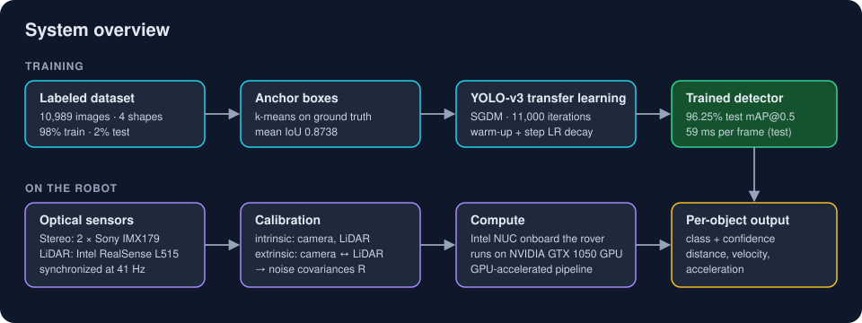
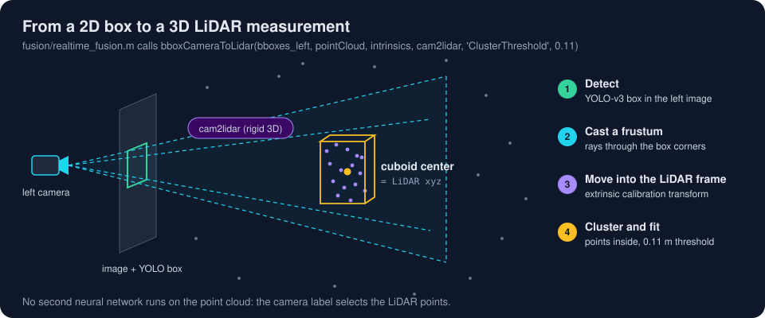
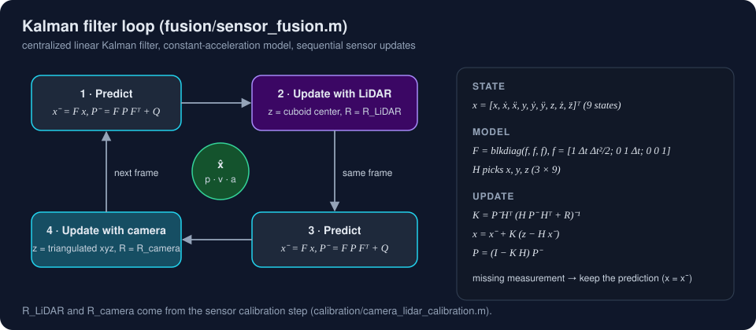
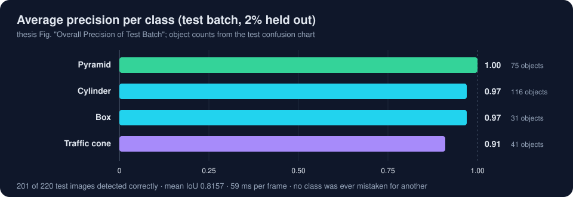
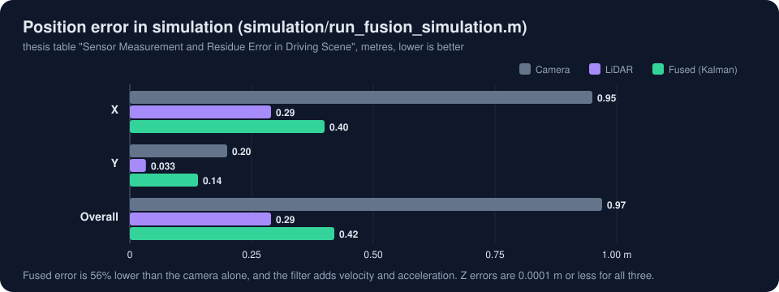
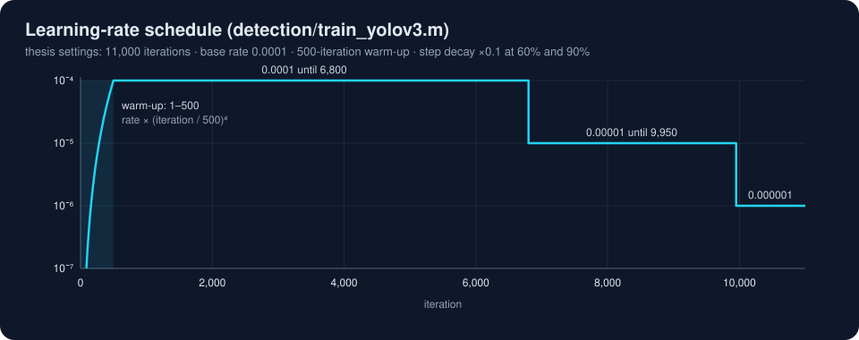
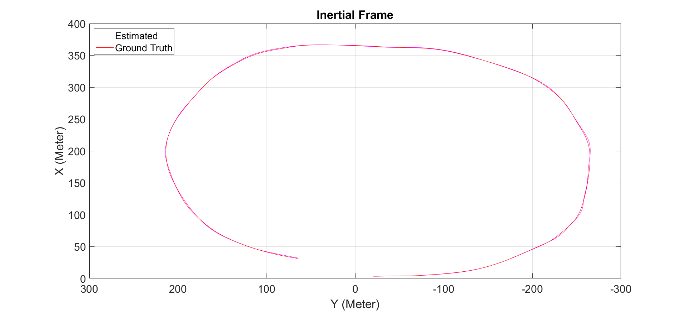
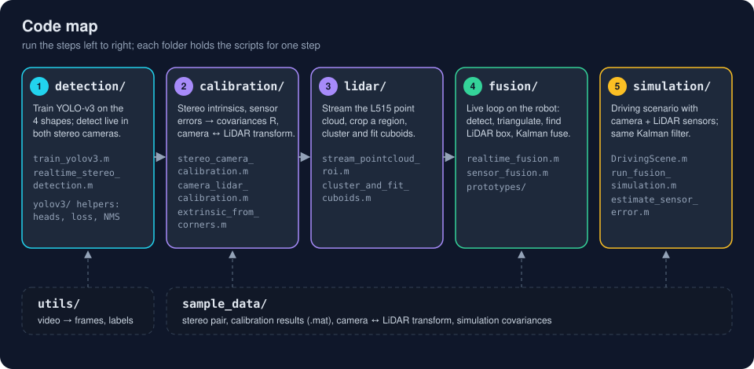

# YOLO-v3 Object Detection and Camera–LiDAR Kalman Fusion in MATLAB

**MATLAB source code of my Master's thesis in Aerospace Engineering, The University of Texas at Arlington (2021).**

A wheeled robot detects four shapes in real time with a YOLO-v3 network that I retrained by transfer learning on 10,989 labeled images. It locates each object twice, by stereo triangulation and by clustering the LiDAR points inside a 3D frustum cast from the camera box. A linear Kalman filter then fuses both positions and estimates position, velocity and acceleration. This repository holds the code for every step: training, calibration, LiDAR processing, real-time fusion on the robot, and the driving-scenario simulation.

[Thesis report (LaTeX + PDF)](https://github.com/kamalkimahek14/MS-Thesis-Report) · [Defense slides](https://github.com/kamalkimahek14/MS-Thesis-Presentation) · [Portfolio: kamal-mehta.com](https://kamal-mehta.com)

*Thesis title: Object Classification, Detection and State Estimation using YOLO v3 Deep Neural Network and Sensor Fusion of Stereo Camera and LiDAR. Supervised by Dr. Kamesh Subbarao, Aerospace Systems Laboratory.*



## Contents

- [How the pipeline works](#how-the-pipeline-works)
- [Key results](#key-results)
- [Code map](#code-map)
- [Requirements](#requirements)
- [Original thesis code and 2026 helpers](#original-thesis-code-and-2026-helpers)
- [Run each step](#run-each-step)
- [Data each step expects](#data-each-step-expects)
- [File map](#file-map)
- [Related](#related) · [Citation](#citation) · [License](#license)

## How the pipeline works



1. **Train** YOLO-v3 (SqueezeNet backbone, two detection heads, 227 × 227 input) on four shapes: cylinder, box, pyramid and traffic cone. Split the data 98% / 2%, estimate 24 anchor boxes by k-means (mean IoU 0.8738), and train for 11,000 iterations with SGDM, a warm-up and step decay.
2. **Calibrate** the stereo camera (two Sony IMX179) and the LiDAR (Intel RealSense L515). Intrinsic calibration gives each sensor's measurement error and noise covariance R; extrinsic calibration gives the rigid camera-to-LiDAR transform.
3. **Detect** in the left and right images with the trained network, and triangulate the matching box centers into a camera position.
4. **Project** the left-camera box into the point cloud as a 3D frustum, cluster the points inside it, and fit a cuboid. Its center is the LiDAR position. No second neural network runs on the point cloud.
5. **Fuse** both positions in a centralized linear Kalman filter with a constant-acceleration model. Each frame runs predict, LiDAR update, predict, camera update.
6. **Test** the same filter in a MATLAB driving scenario with simulated camera and LiDAR sensors, then run it live on the robot.

### From a 2D box to a 3D LiDAR measurement



### Kalman filter loop



The real-time filter in `fusion/sensor_fusion.m` uses these noise settings, taken from the calibration step:

| Matrix | Diagonal (x, y, z) |
|---|---|
| R_LiDAR | 5.84e-5, 2.73e-4, 3.917e-6 |
| R_camera | 2.59e-5, 9.76e-6, 4.46e-4 |
| Q (position, velocity, acceleration blocks) | 0.3 · I₃, 0.2 · I₃, 0.1 · I₃ |

## Key results

All numbers come from the thesis (Chapters 2 and 7).

| Result | Value |
|---|---|
| Training accuracy · test mAP@0.5, 4 classes (the thesis table lists both as accuracy) | 99.08% · 96.25% |
| Images with every object found (test batch) | 201 of 220, with no confusion between classes |
| Mean IoU on the test set | 0.8157 |
| Average detection time (test) | 59 ms per frame |
| Mean IoU of the estimated anchor boxes | 0.8738 |
| Camera intrinsic re-projection error | 0.37 pixels |
| Extrinsic re-projection error | 29.5 mm (camera → LiDAR), −29.42 mm (LiDAR → camera) |
| Fused position error in simulation | 0.42 m, 56% lower than the camera alone (0.97 m) |
| Sensor rate on the robot | 41 Hz, camera and LiDAR synchronized |
| Training time | 7–8 hours on GPU |







<p align="center">
  
  
</p>
<p align="center"><sub>Left: live detections on the robot, labelled with class, confidence and distance. Right: estimated and ground-truth trajectory of the target vehicle in the simulation (inertial frame).</sub></p>

## Code map



| Folder | What it does |
|---|---|
| [`detection/`](detection/) | Trains YOLO-v3 on the labeled shapes, evaluates it on the test batch, and runs live stereo detection with distance. |
| [`detection/yolov3/`](detection/yolov3/) | Holds the YOLO v3 helpers the thesis scripts call: network heads, targets, loss, decoding with NMS, preprocessing and augmentation (2026). |
| [`calibration/`](calibration/) | Calibrates the stereo camera, measures camera and LiDAR errors, and estimates the camera ↔ LiDAR transform. |
| [`lidar/`](lidar/) | Streams the RealSense L515 point cloud, crops a region of interest, clusters points and fits cuboids. |
| [`fusion/`](fusion/) | Runs the real-time loop on the robot and holds the Kalman filter; `prototypes/` holds the first synthetic filter tests. |
| [`simulation/`](simulation/) | Builds the driving scenario, estimates simulated sensor errors, and runs the fusion filter against ground truth. |
| [`utils/`](utils/) | Prepares data: video to frames, rounding of label boxes, ROS bag to PCD. |
| [`sample_data/`](sample_data/) | Holds one stereo calibration pair and the small calibration, transform and covariance files the scripts load. |
| [`docs/`](docs/) | Holds the diagrams and images in this README. |

## Requirements

- **MATLAB R2020b or later.** The 2021 thesis scripts ran in R2020b; `fusion/realtime_fusion.m` needs R2021a or later (below).
- Toolboxes: Deep Learning, Computer Vision, Image Processing, Lidar, Automated Driving (driving scenario), Sensor Fusion and Tracking, and Parallel Computing (GPU training and inference).
- Support packages: *Deep Learning Toolbox Model for SqueezeNet Network*, *MATLAB Support Package for USB Webcams*, and the Intel RealSense SDK 2.0 MATLAB wrapper for the live LiDAR scripts. `utils/rosbag_to_pcd.m` also needs ROS Toolbox.
- Hardware for the live scripts: two USB cameras (the scripts open `webcam(2)` and `webcam(3)`), an Intel RealSense L515, and a CUDA GPU. I used a GTX 1050.
- `detection/yolov3/` uses `resize2dLayer` (Image Processing Toolbox, R2020b), `estimateAnchorBoxes` and `selectStrongestBboxMulticlass` (Computer Vision Toolbox), and `jitterColorHSV`.
- `fusion/realtime_fusion.m` calls `bboxCameraToLidar`, which ships with Lidar Toolbox from R2021a.

## Original thesis code and 2026 helpers

- **Original 2021 thesis code:** every script outside `detection/yolov3/` starts with the line `% Original MS thesis code (2021)`.
- **Built on a MathWorks example:** the 2021 training script was built from MathWorks' *Object Detection Using YOLO v3 Deep Learning* example. The helper functions in `detection/yolov3/` were reimplemented in 2026 from the YOLO v3 paper and keep the same function names, so the script runs unchanged.
- **YOLO v3 helpers, 2026:** `detection/yolov3/` holds the YOLO v3 network heads, targets, loss, decoding and data preparation, implemented from the YOLO v3 paper (Redmon & Farhadi, 2018) and verified in MATLAB. The thesis scripts call these functions by name.
- **Verified in MATLAB R2026b (October 2026):** `detection/yolov3/test_yolov3_helpers.m` passes (box overlap, box encoding and decoding, the ignore rule, preprocessing, mirroring, learning-rate schedule), and `detection/yolov3/smoke_test_training_step.m` builds the full network and trains five steps on a random batch, with the loss falling from 15,377 to 366. Run both first; a full training run on the thesis dataset is the next step.
- **Train:** each head's output is laid out as `[tx ty tw th to class_1 … class_C]` per anchor; train a network with `train_yolov3`.

## Run each step

Set up once:

1. Clone the repository and open MATLAB in its root folder.
2. Put everything on the path: `addpath(genpath(pwd))`.
3. Run the helper self-checks once: `test_yolov3_helpers`, then `smoke_test_training_step`.
4. Change into a step's folder before running its script. The scripts load data with paths relative to their own folder, such as `../sample_data/fusion/transformations.mat`.

| Step | Run from | Command | Needs |
|---|---|---|---|
| Train and evaluate YOLO-v3 | `detection/` | `train_yolov3` | your `gTruth_image.mat` and images, GPU |
| Live stereo detection with distance | `detection/` | `realtime_stereo_detection` | `new_net.mat` (trained network), two cameras |
| Stereo camera calibration | `calibration/` | `stereo_camera_calibration` | `calibration_images/Left`, `calibration_images/Right` |
| View rectified stereo images | `calibration/` | `stereo_rectification_view` | side-by-side stereo camera |
| Capture a calibration frame | `calibration/` | `capture_calibration_frames` | L515 + two cameras |
| Sensor errors and camera ↔ LiDAR transform | `calibration/` | `camera_lidar_calibration` | sample data included |
| Extrinsic transform from board corners | `calibration/` | `extrinsic_from_corners` | sample data included |
| Stream and crop the point cloud | `lidar/` | `stream_pointcloud_roi` | L515 |
| Cluster a saved point cloud | `lidar/` | `cluster_and_fit_cuboids` | a `1.pcd` frame |
| Real-time detection and fusion | `fusion/` | `realtime_fusion` | `YOLOv3net.mat`, L515, two cameras |
| Synthetic filter tests | `fusion/prototypes/` | `fusion_constant_acceleration` | nothing |
| Simulated fusion | `simulation/` | `run_fusion_simulation` | sample data included |
| Simulated sensor errors | `simulation/` | `allData = struct2table(DrivingScene); estimate_sensor_error` | nothing |

After training, save the network and anchors for the live scripts:

```matlab
save('YOLOv3net.mat', 'net', 'anchorBoxes')   % for fusion/realtime_fusion.m
copyfile('YOLOv3net.mat', 'new_net.mat')       % for detection/realtime_stereo_detection.m
```

Place `YOLOv3net.mat` in `fusion/` and `new_net.mat` in `detection/`.

## Data each step expects

```
detection/
├── gTruth_image.mat        # table gTruth_image: Image_FileName, Cylinder, Box, Pyramid, Traffic_cone
├── Image_data/             # labeled JPG frames referenced by Image_FileName
├── YOLOv3net.mat / new_net.mat   # written after training: variables net, anchorBoxes
calibration/
└── calibration_images/
    ├── Left/left1.jpg ... left65.jpg     # checkerboard, 22 mm squares
    └── Right/right1.jpg ... right65.jpg
lidar/
└── 1.pcd                   # one saved L515 frame (ASCII PCD)
utils/
├── video.mp4               # input for video_to_frames.m
├── gtruth.mat              # variable Gtruth, input for round_box_labels.m
└── 1.bag ... 15.bag        # input for rosbag_to_pcd.m
sample_data/                # included
├── calibration/Intrinsic_params.mat   # ground truth + measurements for camera and LiDAR, R_Camera, R_Lidar
├── calibration/Cal_params.mat         # stereoParams for the rectification viewer
├── calibration/stereo_pair/Left1.jpg, Right1.jpg   # one extrinsic calibration pair
├── extrinsic/gtruth_data.mat          # 15 frames × 4 board corners: left, right, LiDAR
├── extrinsic/stereocamCalPerams.mat   # stereoParams used with those corners
├── fusion/stereocamCalPerams.mat      # stereoParams used on the robot
├── fusion/transformations.mat         # cam2lidar rigid transform
└── simulation/sensor_covariance.mat   # R_Camera, R_Lidar for the driving scenario
```

**Labels.** Each class column of `gTruth_image` holds an M × 4 array of `[x y width height]` boxes in pixels for that image. I labeled the frames with the MATLAB Ground Truth Labeler, split videos into frames with `utils/video_to_frames.m`, and rounded box coordinates with `utils/round_box_labels.m`.

## File map

```
yolov3-camera-lidar-fusion/
├── detection/
│   ├── train_yolov3.m                 # dataset split, anchors, network, training loop, test evaluation, AP plots
│   ├── realtime_stereo_detection.m    # live YOLO-v3 on both cameras, triangulated distance per object
│   └── yolov3/                        # 2026 helpers: heads, targets, loss, decoding + NMS, pre-processing
│       ├── squeezenetFeatureExtractor.m, addFirstDetectionHead.m, addSecondDetectionHead.m
│       ├── modelGradients.m, buildYolov3Targets.m, splitHeadOutput.m, decodeHeadBoxes.m
│       ├── yolov3Detect.m, preprocessData.m, augmentData.m, createBatchData.m
│       ├── piecewiseLearningRateWithWarmup.m, configureTrainingProgressPlotter.m, displayLossInfo.m
│       ├── smoke_test_training_step.m # builds the network, trains 5 steps on random data
│       └── test_yolov3_helpers.m      # self-checks; run first
├── calibration/
│   ├── stereo_camera_calibration.m    # checkerboard stereo calibration (Stereo Camera Calibrator export)
│   ├── stereo_rectification_view.m    # live rectified view and disparity
│   ├── capture_calibration_frames.m   # saves an L515 point cloud with a left/right image pair
│   ├── camera_lidar_calibration.m     # sensor error histograms, cam2lidar and lidar2cam transforms
│   └── extrinsic_from_corners.m       # transform from triangulated board corners vs LiDAR corners
├── lidar/
│   ├── stream_pointcloud_roi.m        # L515 streaming with a region of interest
│   └── cluster_and_fit_cuboids.m      # denoise, Euclidean clustering, cuboid and plane fits
├── fusion/
│   ├── realtime_fusion.m              # live loop: detect, triangulate, LiDAR box, Kalman fusion, annotate
│   ├── sensor_fusion.m                # constant-acceleration Kalman filter, LiDAR then camera update
│   └── prototypes/                    # first synthetic constant-velocity and constant-acceleration filters
├── simulation/
│   ├── DrivingScene.m                 # driving scenario with camera and LiDAR (Driving Scenario Designer export)
│   ├── run_fusion_simulation.m        # fusion vs ground truth: position, velocity, acceleration, error plots
│   └── estimate_sensor_error.m        # simulated camera and LiDAR errors and covariances
├── utils/
│   ├── video_to_frames.m
│   ├── round_box_labels.m
│   ├── showReprojectionError.m    # camera and LiDAR error histograms for the calibration scripts
│   └── rosbag_to_pcd.m
├── sample_data/
├── docs/
├── CITATION.cff
└── LICENSE
```

## Related

- **[MS-Thesis-Report](https://github.com/kamalkimahek14/MS-Thesis-Report)**: the full thesis, LaTeX source and PDF.
- **[MS-Thesis-Presentation](https://github.com/kamalkimahek14/MS-Thesis-Presentation)**: the defense slides.
- **[kamal-mehta.com](https://kamal-mehta.com/?r=github)**: my portfolio.

## Citation

GitHub shows a *Cite this repository* button built from [`CITATION.cff`](CITATION.cff).

Kamal Mehta. *Object Classification, Detection and State Estimation using YOLO v3 Deep Neural Network and Sensor Fusion of Stereo Camera and LiDAR*. Master's thesis, The University of Texas at Arlington, 2021.

## License

Released under the [MIT License](LICENSE). Two files are MATLAB exports, as their headers say: `simulation/DrivingScene.m` was generated by the Driving Scenario Designer (MATLAB R2020b, Automated Driving Toolbox), and `calibration/stereo_camera_calibration.m` by the Stereo Camera Calibrator app (December 2020).
